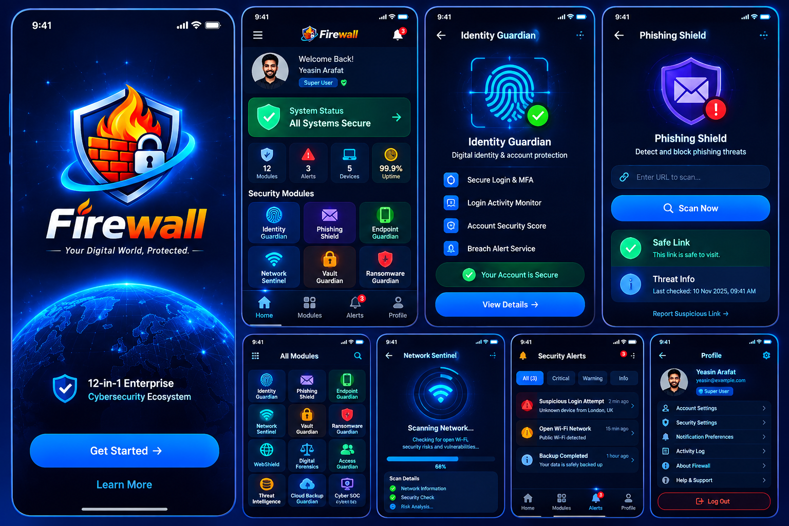

# FIREWALL — 12-in-1 Enterprise Cybersecurity Ecosystem
### *Your Digital World, Protected.*



[](docs/security/SIS_CYBER_FORTRESS_MAPPING.md)
[](docs/security/SIS_CYBER_FORTRESS_MAPPING.md)
[](docs/architecture/BLUEPRINT.md)
[](docs/architecture/BLUEPRINT.md)

---

## 🛡️ Executive Mission

**FIREWALL** is a complete, enterprise-grade cybersecurity ecosystem engineered to protect individuals, developers, and global organizations from sophisticated cyber threats, nation-state actors, ransomware syndicates, and digital surveillance.

Built upon the **SIS Cyber Fortress** engineering framework, FIREWALL brings together twelve autonomous defense modules into a unified mesh spanning Android devices, cloud consoles, web portals, and 24/7 Security Operations Centers (SOC).

---

## 🏛️ Monorepo Structure

```
firewall/
│
├── apps/
│   ├── android/             # Native Android App (Kotlin, Jetpack Compose, Titan M2 Keystore)
│   ├── web/                 # Customer Portal & Security Dashboard (Next.js 14, Tailwind)
│   ├── admin/               # Enterprise SOC Command Center & Advanced Analytics (Next.js 14)
│   └── api/                 # Core Security Engine & Real-time Telemetry Gateway (NestJS, Prisma)
│
├── packages/
│   ├── shared-types/        # TypeScript contracts, interfaces, and shared data schemas
│   ├── api-client/          # Universal HTTP & WebSocket client for Web and Admin
│   ├── ui/                  # Cyber Design System components (GlassCard, StatusBadge, Logo)
│   └── config/              # Tailwind presets, ESLint, and TypeScript configurations
│
├── infrastructure/
│   ├── docker/              # Multi-container Docker Compose (PostgreSQL 16, Redis 7, API, Web, Admin)
│   ├── database/            # Database schema DDL, init scripts, and seed data
│   └── deployment/          # Production Nginx reverse proxy configuration & GitHub Actions CI/CD
│
├── docs/
│   ├── architecture/        # Architecture blueprints, data flows, and zero-trust diagrams
│   ├── security/            # SIS Cyber Fortress controls & ASVS 5.0 compliance matrix
│   ├── api/                 # OpenAPI 3.0 REST & WebSocket event documentation
│   └── user-guides/         # Administrator manual, deployment instructions, and playbooks
│
├── tests/                   # Automated E2E test suites, security SAST, and cryptographic checks
├── .env.example             # Documented environment configuration template
└── README.md                # Master ecosystem documentation
```

---

## ⚡ The 12 Integrated Defense Pillars

1. **Identity Guardian**: Hardware-backed biometric MFA, real-time dark web leak monitoring, and session anomaly detection.
2. **Phishing Shield**: Machine-speed heuristic URL scanner, malicious redirect interceptor, and email attachment sandboxing.
3. **Endpoint Guardian**: Android Titan M2 / TrustZone hardware enclave verification, root/jailbreak detection, and OS patch audits.
4. **Network Sentinel**: Continuous Wi-Fi vulnerability audit, ARP spoofing shield, open port analyzer, and rogue AP blocker.
5. **Vault Guardian**: Client-side AES-256-GCM zero-knowledge encrypted credential, SSH key, and confidential note vault.
6. **Ransomware Guardian**: Cryptographic canary honeypot files and high-entropy process termination.
7. **WebShield**: DNS-over-HTTPS (DoH) encrypted pipeline and telemetry tracking sinkhole.
8. **Digital Forensics**: SHA-256 hash-chained immutable audit ledger for compliance and incident replay.
9. **Access Guardian**: Zero-Trust Network Access (ZTNA) with adaptive geofencing and instant device revocation.
10. **Threat Intelligence**: STIX/TAXII v2.1 continuous ingestion of 1.2M+ global IOC threat indicators and CVE feeds.
11. **Cloud Backup Guardian**: Ransomware-proof immutable cloud snapshots with one-click disaster recovery.
12. **Cyber SOC**: Central SIEM security operations command with real-time telemetry streaming and automated SOAR playbooks.

---

## 📱 Native Android Application (21 Screens)

The native Android app is engineered using **Kotlin** and **Jetpack Compose**, implementing all 21 screens specified in the design blueprint:

1. **Splash Screen**: Animated branding with glowing orbital rings.
2. **Onboarding**: Interactive feature progression.
3. **Welcome Screen**: Deep space globe graphic, 12-in-1 badge, "Get Started ->" CTA.
4. **Login**: Secure credential gateway with biometric fallback.
5. **Registration**: Enclave enrollment and cryptographic master key generation.
6. **Forgot Password**: Hardware challenge dispatch.
7. **MFA Verification**: TOTP RFC 6238 token validator.
8. **Home Dashboard**: Welcome Yeasin Arafat ("Super User"), "All Systems Secure" banner, 4 metric cards (12 Modules, 3 Alerts, 5 Devices, 99.9% Uptime), modules quick grid.
9. **All Security Modules**: Complete 12-module grid with search and category filtering.
10. **Individual Module Screens**: Detailed controls for all 12 modules (including Identity Guardian fingerprint graphic and Phishing Shield URL scanner).
11. **Security Alerts**: All (3), Critical, Warning, and Info filter tabs.
12. **My Devices**: 5 enrolled endpoints with instant revocation.
13. **Scan History**: Full historical audit trail of security sweeps.
14. **Threat Reports**: Zero-day CVE and MITRE ATT&CK correlation.
15. **Secure Vault**: Client-side encrypted secrets manager.
16. **Backup Center**: Cloud snapshot sync and backup integrity monitor.
17. **Network Security**: Concentric radar scanning animation with 68% progress bar and live checklists.
18. **Account Profile**: User card, security badges, profile menu, and red outlined logout.
19. **Security Settings**: Hardware Keystore, Titan M2, and biometric preferences.
20. **Notification Settings**: Push alert severity thresholds.
21. **Help & Support**: 24/7 SOC emergency hotline and PGP key verification.

---

## 🚀 Getting Started

### 1. Clone & Install Monorepo
```bash
git clone https://github.com/firewall-cyber/firewall.git
cd firewall
npm install
```

### 2. Configure Environment
```bash
cp .env.example .env
```

### 3. Run Development Services
```bash
# Terminal 1: NestJS Security API (Port 4000)
npm run dev:api

# Terminal 2: Next.js Customer Console (Port 3000)
npm run dev:web

# Terminal 3: Enterprise SOC Admin Console (Port 3001)
npm run dev:admin
```

### 4. Run with Docker Compose
```bash
docker-compose -f infrastructure/docker/docker-compose.yml up --build -d
```

### 5. Access Endpoints
- **Web Portal:** [http://localhost:3000](http://localhost:3000)
- **SOC Admin Console:** [http://localhost:3001](http://localhost:3001)
- **API & Swagger Docs:** [http://localhost:4000/api/docs](http://localhost:4000/api/docs)
- **Real-Time WebSocket:** `ws://localhost:4000`

---

## 🔑 Default Demonstration Accounts

| Name | Email | Password | Role |
| :--- | :--- | :--- | :--- |
| **Yeasin Arafat** | `yeasin@example.com` | `Firewall@2026!` | Super User |
| **SecOps Admin** | `admin@firewall.cyber` | `SecOps#GodMode2026` | Super Admin |

*Demo MFA Bypass Token: `123456`*

---

## 📜 Compliance & Security Accreditations

- **ASVS 5.0 Level 3:** Verified application security verification standard.
- **NIST SP 800-218:** Secure Software Development Framework (SSDF) compliant.
- **FIPS 140-3:** Cryptographic algorithms and module validation.
- **SOC 2 Type II & ISO 27001:** Enterprise continuous audit readiness.
