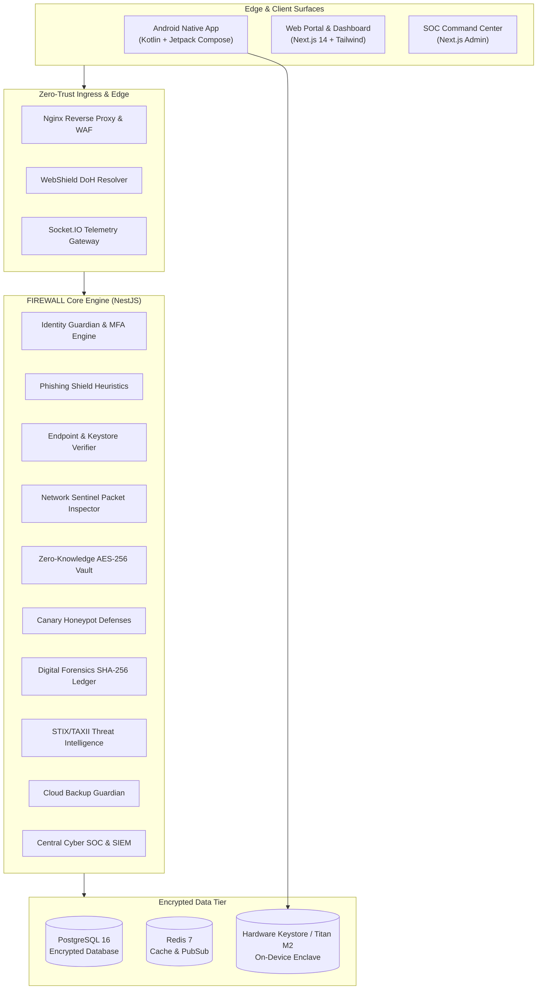

# FIREWALL — Architecture Blueprint
### 12-in-1 Enterprise Cybersecurity Ecosystem

## 1. Executive Summary

FIREWALL is an enterprise-grade autonomous cybersecurity platform delivering real-time zero-trust defense across mobile endpoints, cloud infrastructure, and distributed corporate environments.

## 2. Core Pillars & Technology Stack

| Layer | Primary Technology | Security Role |
| :--- | :--- | :--- |
| **Android Client** | Kotlin, Jetpack Compose | Hardware Titan M2 Keystore, Tier 3 BiometricPrompt, WorkManager |
| **Customer Web** | Next.js 14, Tailwind CSS, TypeScript | Customer security posture console & zero-knowledge vault manager |
| **Admin SOC** | Next.js 14, Advanced Analytics | Real-time SIEM event triage, MITRE ATT&CK correlation, SOAR playbooks |
| **Backend API** | NestJS, TypeScript, WebSocket | Microsecond heuristic scanning, REST endpoints, real-time telemetry |
| **Database Tier** | PostgreSQL 16, Redis 7, Prisma ORM | Relational event audit, session caching, threat feed storage |
| **Infrastructure** | Docker, Nginx WAF, GitHub Actions | Containerized isolated microservices, automated ASVS 5.0 SAST/DAST |
